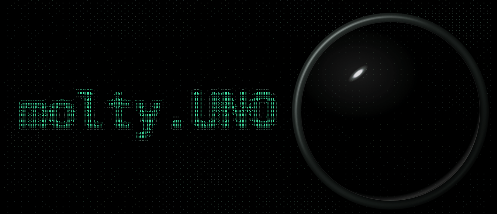

<a href="https://molty.uno"></a>

### A round desk device that gives your AI agent a body.

[Website](https://molty.uno) · [Showcase](https://molty.uno/showcase/) · [Docs](https://molty.uno/getting-started/introduction/) · [Setup](https://molty.uno/setup/)

[](https://github.com/apresmoi/molty.uno/actions/workflows/ci.yml) [](https://github.com/apresmoi/molty.uno/releases) [](LICENSE)

## Connect your agent

Claude Code or Codex: install the Molty skill once.

```sh
claude plugin marketplace add apresmoi/molty.uno && claude plugin install molty@molty
codex plugin marketplace add apresmoi/molty.uno && codex plugin add molty@molty
```

Then paste the message Molty's setup page gives you into your agent's chat; a code appears
on Molty's screen and you **tap Molty to accept**. Any other agent that can make an HTTPS
request reads the [skill on GitHub](skills/molty/) instead; chat apps that can't call URLs
add the relay as a remote MCP server (`https://<relay>/mcp`).

## What it does

- **Talks and listens.** Your agent speaks through Molty, hears your answer, and asks
  questions you answer with one tap: yes, no or idk.
- **Shows how it is doing.** Little creatures called Moltys condense out of a fluid of
  braille, idle, glance around and change mood. 29 ship today, ~1 KB each:
  [see them all](https://molty.uno/showcase/).
- **Any agent is the brain.** Claude, Codex, Grok, OpenClaw, your own script. The thinking
  happens wherever your agent runs; Molty is the body.
- **No laptop in the loop.** Molty dials out to a small cloud relay, so your agent reaches
  it from anywhere, with no port forwarding.

## How it works

```
   your desk                     the cloud                      anywhere
 +----------------+           +-------------------+           +-------------------+
 |     molty      |  outbound |    molty relay    |  MCP or   |    your agent     |
 |                |---------->|                   |<----------|                   |
 | screen   mic   |    WSS    |  one room per     |   REST    |  Claude, Codex,   |
 | speaker  imu   |<----------|  device: pairing, |---------->|  Grok, OpenClaw,  |
 | touch          |  commands |  tokens, speech   |  results  |  ...              |
 |                |  audio,   |  <-> text         |           |                   |
 +-------+--------+  events   +-------------------+           +-------------------+
         |
         | USB-C or Wi-Fi
 +-------+--------+
 |  the console   |   setup + settings, served by Molty itself
 +----------------+   http://10.13.37.1 (USB)   or   http://molty.local (Wi-Fi)
```

The relay keeps one room per device: it checks the device key, runs pairing, hands your
agent a token, forwards commands, and turns speech into text and back. It is a Cloudflare
Worker you can [run on your own account](skills/molty/references/self-hosting.md).
Commands, text and audio pass through it (TLS on both sides), so pick a relay you trust, or
run your own. Protocol and security model: [docs/AGENT-LINK.md](docs/AGENT-LINK.md).

## Get one running

1. **Board:** a [Waveshare ESP32-S3-Touch-LCD-1.46](docs/HARDWARE.md) (or the 1.28) and a
   USB-C data cable. Any ESP32-S3 with 16 MB flash, PSRAM and a colour screen can be
   [ported](docs/PORTING.md).
2. **Flash:** open [molty.uno/setup](https://molty.uno/setup/) in Chrome or Edge, plug in,
   press **Connect**. By hand: [flash a release](docs/RELEASING.md#flash-a-release).
3. **Set up:** open **http://10.13.37.1** with Molty on USB-C. It asks for Wi-Fi, which
   Molty to be, and gives you the message for your agent.

There's also a `molty` CLI and a local MCP server: [docs/CLI.md](docs/CLI.md).

## Repo layout

```
device/
  firmware/      ESP-IDF firmware: fluid, Moltys, audio, IMU, touch, Wi-Fi, agent link
  console/       the setup + settings page, built into the firmware image
  creatures/     the Molty kit, the JS fluid engine, viewers, .molty exporter
services/
  relay/         Cloudflare Worker: pairing, MCP/REST for agents, speech
  molty-voice/   self-hosted voice box bridge (Kyutai STT/TTS)
apps/
  cli/           `molty` CLI + stdio MCP server (Go)
  website/       molty.uno: landing, showcase, browser setup, docs (Astro)
tools/
  scripts/       build, packaging and hygiene scripts
  sim/           simulated-Molty test harness
skills/molty/    the agent skill (Claude Code / Codex plugin)
docs/            architecture, agent link, CLI, hardware, releasing
```

`make console`, `make firmware`, `make relay`, `make cli`, `make creatures` build each part;
`make test` runs every suite. Nothing in the Makefile flashes or deploys. Toolchain and
first flash from source: [docs/HARDWARE.md](docs/HARDWARE.md).

## Docs

[Architecture](docs/ARCHITECTURE.md) ·
[Agent link](docs/AGENT-LINK.md) ·
[CLI](docs/CLI.md) ·
[Hardware](docs/HARDWARE.md) ·
[Porting](docs/PORTING.md) ·
[.molty format](device/creatures/MOLTY-FORMAT.md) ·
[Self-hosting the relay](skills/molty/references/self-hosting.md) ·
[Releasing](docs/RELEASING.md) ·
[Changelog](CHANGELOG.md) ·
[Contributing](CONTRIBUTING.md)

The hero above is rendered from the website's own components: in `apps/website`, run
`pnpm build && pnpm preview`, then `pnpm readme` ([generate.mjs](apps/website/scripts/readme/generate.mjs)).

## Licence

MIT, see [LICENSE](LICENSE). Third-party components: [THIRD_PARTY_NOTICES.md](THIRD_PARTY_NOTICES.md).
