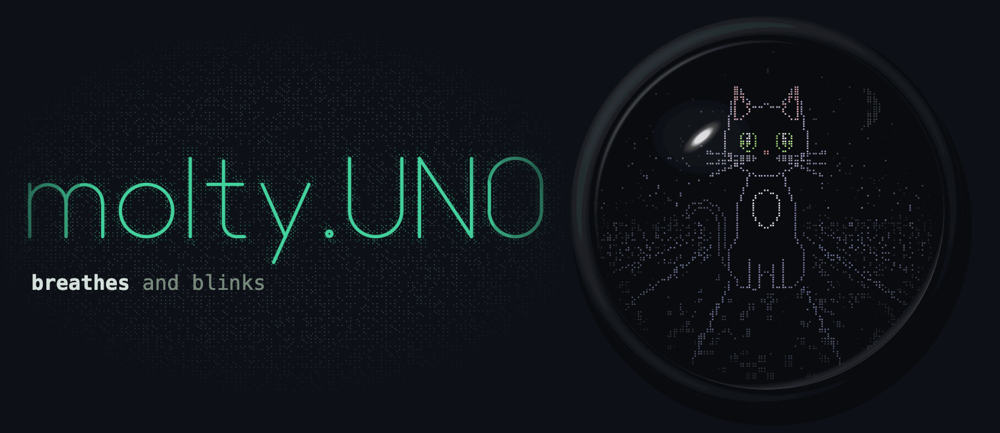
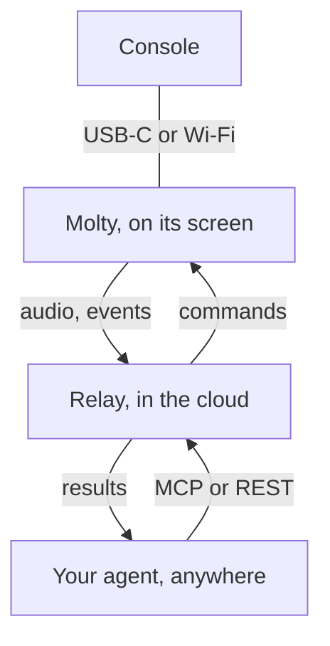

<picture>
  <source media="(prefers-color-scheme: light)" srcset="docs/assets/molty-hero-light.webp">
  
</picture>

### A creature your AI agent speaks through.

[Website](https://molty.uno) · [Showcase](https://molty.uno/showcase/) · [Docs](https://molty.uno/getting-started/introduction/) · [Setup](https://molty.uno/setup/)

[](https://github.com/apresmoi/molty.uno/actions/workflows/ci.yml) [](https://github.com/apresmoi/molty.uno/releases) [](LICENSE)

Molty is the interface for your agent: a creature drawn in braille dots that your agent can
control to talk to you, listen, ask a question you answer with a tap, and show its mood.

Any agent can be the brain. Molty keeps breathing, blinking and reacting at once while your
agent thinks.

Open source. It runs today on three small ESP32-S3 touch screens, and can be adapted to any
device that can run it.

## Connect your agent

Claude Code or Codex: install the Molty skill once.

```sh
claude plugin marketplace add apresmoi/molty.uno && claude plugin install molty@molty
codex plugin marketplace add apresmoi/molty.uno && codex plugin add molty@molty
```

Then paste the message Molty's setup page gives you into your agent's chat; a code appears
on Molty's screen and you **tap Molty to accept**. Any other agent that can make an HTTPS
request reads the [skill on GitHub](skills/molty/) instead; chat apps that can't call URLs
add the relay as a remote MCP server (`https://<relay>/mcp`).

## What it does

- **Talks and listens.** Your agent speaks through Molty, hears your answer, and asks
  questions you answer with one tap: yes, no or idk.
- **Shows how it is doing.** The creature breathes, blinks, grooms itself, glances around and
  changes mood, and every change of picture is a dissolve through dust. Three ship in the
  firmware today: the cat (the default), a duck and an octopus. [See what they do](https://molty.uno/showcase/).
- **Skills bring their own screens.** [molty-astro](skills/molty-astro/) draws a sky chart, the
  planets and the signs; [molty-rhythm](skills/molty-rhythm/) a metronome that plays rhythms
  from around the world as a clock.
- **Any agent is the brain.** Claude, Codex, Grok, OpenClaw, your own script. The thinking
  happens wherever your agent runs; Molty is what it speaks through.
- **No laptop in the loop.** Molty dials out to a small cloud relay, so your agent reaches
  it from anywhere, with no port forwarding.

## How it works



The boards it runs on today have a touch screen, a mic, a speaker and a motion sensor (the 1.28
has no audio). Molty dials out to the relay over WSS. Your agent is
Claude, Codex, Grok, OpenClaw or any other. The console is setup and settings, served by Molty itself at
`http://10.13.37.1` (USB) or `http://molty.local` (Wi-Fi).

The relay keeps one room per device: it checks the device key, runs pairing, hands your
agent a token, forwards commands, and turns speech into text and back. It is a Cloudflare
Worker you can [run on your own account](skills/molty/references/self-hosting.md).
Commands, text and audio pass through it (TLS on both sides), so pick a relay you trust, or
run your own. Protocol and security model: [docs/AGENT-LINK.md](docs/AGENT-LINK.md).

## Get one running

1. **Board:** a [Waveshare ESP32-S3-Touch-LCD-1.46](docs/HARDWARE.md), the reference board
   (the AMOLED 1.75C and the 1.28 run it too), and a USB-C data cable. Any ESP32-S3 with 16 MB flash, PSRAM and a colour screen can be
   [ported](docs/PORTING.md).
2. **Flash:** open [molty.uno/setup](https://molty.uno/setup/) in Chrome or Edge, plug in,
   press **Connect**. By hand: [flash a release](docs/RELEASING.md#flash-a-release).
3. **Set up:** open **http://10.13.37.1** with Molty on USB-C (the 1.28: Wi-Fi setup from
   the same setup page). It asks for Wi-Fi, which Molty to be, and gives you the message for
   your agent.

There's also a `molty` CLI and a local MCP server: [docs/CLI.md](docs/CLI.md).

## Repo layout

```
device/
  firmware/      ESP-IDF firmware: fluid, Moltys, audio, IMU, touch, Wi-Fi, agent link
                 (web/: its renderer as WebAssembly, what the website's screens run)
  console/       the setup + settings page, built into the firmware image
  creatures/     the Molty kit, the JS fluid engine, viewers, .molty exporter
packages/        creature and scene packages: cat, duck, octopus, astrology, rhythm
moltys/cat/      the cat's source (Blender rig and its molty.json)
services/
  relay/         Cloudflare Worker: pairing, MCP/REST for agents, speech
  molty-voice/   self-hosted voice box bridge (Kyutai STT/TTS)
apps/
  cli/           `molty` CLI + stdio MCP server (Go)
  website/       molty.uno: landing, showcase, browser setup, docs (Astro)
tools/
  scripts/       build, packaging and hygiene scripts
  sim/           simulated-Molty test harness
skills/          the agent skills: molty, molty-astro, molty-rhythm (Claude Code / Codex plugin)
docs/            architecture, agent link, CLI, hardware, releasing
```

`make console`, `make firmware`, `make relay`, `make cli`, `make creatures`, `make packages` build each part;
`make web-molty` rebuilds the website's Molty from the firmware sources; `make test` runs every
suite. Nothing in the Makefile flashes or deploys. Toolchain and
first flash from source: [docs/HARDWARE.md](docs/HARDWARE.md).

## Docs

[Architecture](docs/ARCHITECTURE.md) ·
[Agent link](docs/AGENT-LINK.md) ·
[CLI](docs/CLI.md) ·
[Hardware](docs/HARDWARE.md) ·
[Porting](docs/PORTING.md) ·
[Packages](docs/PACKAGES.md) ·
[.molty format](device/creatures/MOLTY-FORMAT.md) ·
[Self-hosting the relay](skills/molty/references/self-hosting.md) ·
[Releasing](docs/RELEASING.md) ·
[Changelog](CHANGELOG.md) ·
[Contributing](CONTRIBUTING.md)

The hero above is rendered from the website's own components: in `apps/website`, run
`pnpm build && pnpm preview`, then `pnpm readme` ([generate.mjs](apps/website/scripts/readme/generate.mjs)).

## Licence

MIT, see [LICENSE](LICENSE). Third-party components: [THIRD_PARTY_NOTICES.md](THIRD_PARTY_NOTICES.md).
