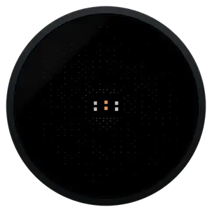

<div align="center">


**A calm creature of characters for your desk.**
A round screen of flowing braille. Little Moltys live in it. Your AI agent is its brain.

[](https://github.com/apresmoi/molty.uno/actions/workflows/ci.yml)
[](https://github.com/apresmoi/molty.uno/releases)
[](LICENSE)



</div>

## What it is

molty.UNO is a small round-screen device, a Waveshare ESP32-S3 board with a 412×412
display, mic, speaker and motion sensor. Everything on the screen is **one fluid of
characters**: dim braille that is always moving, and that condenses into a Molty, into
words, into ripples and vortices, then melts back.

- **Moltys** are tiny creatures stored as ~1 KB `.molty` files. Swap them any time, no
  recompile. 29 ship today; see them all, with their moods and actions, at
  [molty.uno/showcase](https://molty.uno/showcase/).
- **Any agent is the brain.** Claude, Grok, OpenClaw, your own script. Molty is the body:
  it shows, speaks, listens and feels taps. The thinking happens wherever your agent runs.
- **No laptop in the loop.** Molty dials out to a small cloud relay; your agent reaches it
  from anywhere.


## How it works

```
   your desk                     the cloud                      anywhere
 +----------------+           +-------------------+           +-------------------+
 |     molty      |  outbound |    molty relay    |  MCP or   |    your agent     |
 |                |---------->|                   |<----------|                   |
 | screen   mic   |    WSS    |  one room per     |   REST    |  Claude, Grok,    |
 | speaker  imu   |<----------|  device: pairing, |---------->|  OpenClaw, ...    |
 | touch          |  commands |  tokens, speech   |  results  |  (runs wherever   |
 |                |  audio,   |  <-> text         |           |   you like)       |
 +-------+--------+  events   +-------------------+           +-------------------+
         |
         | USB-C or Wi-Fi
 +-------+--------+
 |  the console   |   setup + settings, served by Molty itself
 +----------------+   http://10.13.37.1 (USB)   or   http://molty.local (Wi-Fi)
```

- **Molty connects out**, so it works behind any home router with no port forwarding.
- **The relay** keeps one room per device. It checks the device key, runs pairing, hands
  agents a token, forwards commands, and turns speech into text and text into speech.
- **Your agent** talks to the relay over remote MCP or plain REST, with the token it got
  when you tapped "accept" on Molty.

## Get started

### 1. Hardware

A **Waveshare ESP32-S3-Touch-LCD-1.46** (or the 1.28) and a USB-C data cable. That's all.
Details: [docs/HARDWARE.md](docs/HARDWARE.md).

Another screen? Molty needs an **ESP32-S3** with **16 MB flash** and **PSRAM** (2 MB or
more) driving a colour display; touch, IMU, mic, speaker and battery are optional.
[Port it to your board](docs/PORTING.md).

### 2. Flash the firmware

Easiest: open **[molty.uno/setup](https://molty.uno/setup/)** in Chrome or Edge, plug the
board in over USB-C and press **Connect**. It flashes the latest release for your board
from the browser.

Or by hand: download `molty-X.Y.Z-<board>-factory.bin` from the
[latest release](https://github.com/apresmoi/molty.uno/releases) (e.g.
`waveshare-esp32-s3-touch-lcd-1.46`), hold **BOOT** while plugging in USB-C, then:

```sh
pip install esptool
python -m esptool --chip esp32s3 -p PORT -b 460800 write_flash 0x0 molty-X.Y.Z-<board>-factory.bin
```

Replug, and the fluid starts. Later updates keep your settings: send
`molty-X.Y.Z-<board>-ota.bin` to `/api/ota` (see [docs/RELEASING.md](docs/RELEASING.md#flash-a-release)).

### 3. Set it up in the console

Molty serves its own setup page. Open **http://10.13.37.1** with Molty plugged in over
USB-C (it shows up as a network adapter). Molty asks three things, one per screen:

```
  1. "Which Wi-Fi should I use?"   pick a network, type the password
  2. "Who should I be?"             tap a Molty: it emerges from the fluid and dances
  3. "Who will be my brain?"        copy one message for your agent
```

After that, the console lives at **http://molty.local** on your Wi-Fi, with status,
Moltys, agent and diagnostics pages.

### 4. Connect your agent

The console gives you **one message**. Paste it into your agent's chat:

```
Hi! Please connect yourself to my Molty.

Skill: https://github.com/apresmoi/molty.uno/tree/main/skills/molty
Device: molty-xxxxxxxxxx
Code: K7M2W9C4

I'll tap Molty to accept you.
```

The agent reads the skill, asks to pair, and a 4-digit code appears on
Molty's screen. **Tap Molty to accept.** Done. Your agent can now show, say, listen and
change moods.

**Claude Code or Codex?** Install the Molty skill once (the console shows these lines too),
then paste the message:

```sh
claude plugin marketplace add apresmoi/molty.uno
claude plugin install molty@molty
```

```sh
codex plugin marketplace add apresmoi/molty.uno
codex plugin add molty@molty
```

The skill lives in [`skills/molty/`](skills/molty/) and ships only through these git
marketplaces; other agents read it on GitHub. Update it with `claude plugin update molty@molty`
(after `claude plugin marketplace update molty`) or `codex plugin marketplace upgrade molty`.

Works with **any agent that can make an HTTPS request**: Claude Code, Grok bots,
OpenClaw, Cursor, a shell script. Chat-only apps that can't call URLs can add the relay as
a remote MCP server (`https://<relay>/mcp`) in their settings instead. There's also a
`molty` CLI and a local MCP server: [docs/CLI.md](docs/CLI.md).

## The relay

Moltys connect to the hosted relay by default. You can **run your own** on a free
Cloudflare account in a couple of minutes:

```sh
git clone https://github.com/apresmoi/molty.uno && cd molty.uno/relay
pnpm install
npx wrangler login
npx wrangler deploy                     # prints https://molty-relay.<you>.workers.dev
```

Then point Molty at it: console → **Agent** → **Advanced** → relay, set
`wss://molty-relay.<you>.workers.dev`, and save. Molty reconnects to your relay.
Before deploying on your own account, drop the `d1_databases` block from
`relay/wrangler.jsonc` (it is the project's waitlist). Step by step, with what changes for
agents: [self-hosting](skills/molty/references/self-hosting.md).

- **Voice** uses Cloudflare Workers AI by default. To use OpenAI instead, run
  `npx wrangler secret put OPENAI_API_KEY` and set `VOICE_PROVIDER` to `openai`.
- **What the relay sees:** commands, text and audio pass through it (TLS on both sides),
  so pick a relay you trust, or run your own.
- Protocol, pairing and security model: [docs/AGENT-LINK.md](docs/AGENT-LINK.md).
  Relay internals: [relay/README.md](relay/README.md).

## Build from source

```
firmware/    ESP-IDF firmware: fluid, Molty runtime, audio, IMU, touch, USB-C + Wi-Fi, agent link
console/     the setup + settings page, built into the firmware image
relay/       Cloudflare Worker: pairing, MCP/REST for agents, speech
cli/         `molty` CLI + stdio MCP server (Go)
creatures/   the Molty kit, the JS fluid engine, viewers, .molty exporter
website/     molty.uno: landing, Molty showcase, browser setup, docs (Astro + @glyphcss/fluid)
docs/        architecture, agent link, CLI, hardware, releasing
```

| Component | Build | Test |
|---|---|---|
| console | `make console` | `make console-test`, `make console-e2e` |
| firmware | `make firmware` (after `make console`; other boards: `BOARD=<vendor>/<model>`, `make firmware-all`) | `make firmware-test` |
| relay | `make relay` | `make relay-test` |
| cli | `make cli` | `make cli-test` |
| creatures | `make creatures` | covered by `make firmware-test` |

`make test` runs every suite; nothing in the Makefile flashes or deploys. Toolchain and
first flash from source: [docs/HARDWARE.md](docs/HARDWARE.md). Releases:
[docs/RELEASING.md](docs/RELEASING.md).

## Docs

[Architecture](docs/ARCHITECTURE.md) ·
[Agent link](docs/AGENT-LINK.md) ·
[CLI](docs/CLI.md) ·
[Hardware](docs/HARDWARE.md) ·
[Porting](docs/PORTING.md) ·
[.molty format](creatures/MOLTY-FORMAT.md) ·
[Releasing](docs/RELEASING.md) ·
[Changelog](CHANGELOG.md) ·
[Contributing](CONTRIBUTING.md)

## Licence

MIT, see [LICENSE](LICENSE). Third-party components: [THIRD_PARTY_NOTICES.md](THIRD_PARTY_NOTICES.md).
