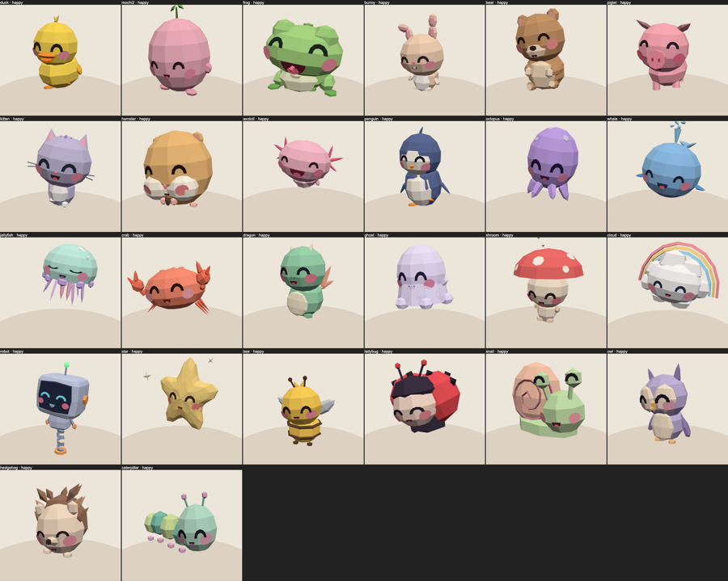

# Molty

[](https://github.com/apresmoi/molty.uno/actions/workflows/ci.yml)
[](https://github.com/apresmoi/molty.uno/releases)

A small creature that lives on your desk and gives an AI agent a body: a round screen,
a voice, ears, and a sense of being picked up. Molty runs on a Waveshare
ESP32-S3-Touch-LCD-1.46 (and the 1.28; [port it to your board](docs/PORTING.md)). The
agent runs wherever you like — Molty is the surface, not the brain.



- **Fluid of characters.** Everything on screen is one fluid drawn as text that flows
  into shapes: a blob, a thinking swirl, speed-read words, or one of 26 creatures.
- **Swappable creatures.** A creature is a ~1 KB `.molty` file uploaded at runtime.
- **Any agent.** Pair an agent with a code shown on the device and a tap; it then drives
  Molty over MCP or REST through a small relay, or directly over the local network.

## Layout

```
firmware/    ESP-IDF firmware (fluid, creature runtime, audio, IMU, touch, USB-C + Wi-Fi, agent link)
console/     setup + settings web UI, built into the firmware image
relay/       Cloudflare Worker: pairing, MCP/REST for agents, TTS/STT
cli/         `molty` CLI + stdio MCP server (Go)
creatures/   cute-kit creature specs, JS fluid engine, viewers, .molty exporter
docs/        architecture, agent-link protocol, CLI, hardware + flashing
```

## Build and test

Prerequisites and flashing: [docs/HARDWARE.md](docs/HARDWARE.md).

| Component | Build | Test |
|---|---|---|
| console | `make console` | `make console-test`, `make console-e2e` |
| firmware | `make firmware` (after `make console`; other boards: `BOARD=<vendor>/<model>`, `make firmware-all`) | `make firmware-test` |
| relay | `make relay` | `make relay-test` |
| cli | `make cli` | `make cli-test` |
| creatures | `make creatures` (re-export `.molty` files) | covered by `make firmware-test` |

`make test` runs every unit/host suite. Nothing in the Makefile flashes or deploys.
CI runs all of it on every pull request; see [docs/RELEASING.md](docs/RELEASING.md#ci).

Prebuilt firmware (OTA and full factory images), the console page and `molty` CLI
binaries are attached to each [GitHub Release](https://github.com/apresmoi/molty.uno/releases).

## Docs

- [Architecture](docs/ARCHITECTURE.md) — how the pieces fit
- [Agent link](docs/AGENT-LINK.md) — device ↔ relay ↔ agent protocol, pairing, default relay
- [CLI](docs/CLI.md) — `molty` verbs and MCP setup
- [Hardware](docs/HARDWARE.md) — supported boards, build, first flash, OTA
- [Porting](docs/PORTING.md) — bake molty.UNO for your own screen
- [.molty format](creatures/MOLTY-FORMAT.md) — the creature file
- [Releasing](docs/RELEASING.md) — versioning, cutting a release, flashing a release image, CI
- [Changelog](CHANGELOG.md)
- [Contributing](CONTRIBUTING.md)

## Licence

MIT — see [LICENSE](LICENSE). Third-party components and their licences:
[THIRD_PARTY_NOTICES.md](THIRD_PARTY_NOTICES.md).
