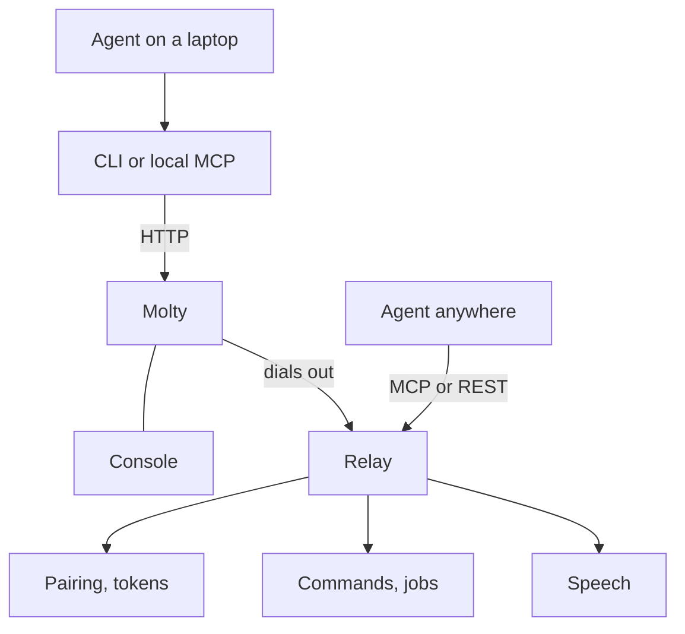

# Architecture

Molty is a **surface, not an agent**. The device is a thin client: a round screen, a
mic, a speaker, an IMU and touch. The brain is whatever agent you connect (a local
CLI agent, a cloud bot, a chat app). Agents drive Molty through one small command
set over either path below.

| Agents can | commands |
|---|---|
| speak and listen | `say`, `listen`, `talk` (both in one call), `quick`, `keep` |
| ask a tap question | `ask` (1 to 5 answers on the screen) |
| show and emote | `show`, `mood`, `act`, `progress` |
| draw scenes | `pkg.available`, `pkg.install`, `scene.play`, `scene.queue`, `scene.clear` |
| pick the creature | `creature.list`, `creature.select` |
| read and tune | `status`, `state`, `volume`, `gestures`, `imu`, `diag`, `log` |

The relay has all of them ([AGENT-LINK.md](AGENT-LINK.md#commands)); the local CLI has the first small set
([CLI.md](CLI.md)).



- **At home** (same LAN or USB-C): the `molty` CLI or its MCP server talks HTTP to Molty (an ESP32-S3) at
  `10.13.37.1` or `molty.local`.
- **From anywhere**: the agent talks MCP or REST to the relay, a Cloudflare Worker with one Durable Object per
  device. Molty reaches it over outbound WSS.
- **The relay** does pairing (a link code plus a tap on the device) and agent tokens, command routing and async
  jobs (`say` / `listen`), and speech through a TTS / STT provider (Workers AI, OpenAI or none).
- **The console** is one HTML file served by the device. Setup: Wi-Fi, pick a Molty, connect an agent, voice.

## Components

| Dir | What | Talks to |
|---|---|---|
| `device/firmware/` | ESP-IDF app: fluid renderer, creature package player, scene player, HTTP API, agent-link client, USB-C NCM + Wi-Fi; one board folder per supported board (display, touch, IMU, audio drivers) | relay (WSS out), console + CLI (HTTP in) |
| `device/console/` | Setup + settings UI, built to one HTML file and baked into the firmware's SPIFFS image | device HTTP API |
| `services/relay/` | Cloudflare Worker: device sockets, pairing, REST + remote MCP, voice | devices, agents |
| `apps/cli/` | `molty` CLI + stdio MCP server, direct HTTP or via the relay | device or relay |
| `device/creatures/` | The JS fluid engine and the JS reference players | console (imported at build time) |
| `packages/` | Data-only packages the device plays: the duck, cat and octopus creatures (built in) and the astrology scenes ([PACKAGES.md](PACKAGES.md)) | firmware (embedded at build time, or downloaded by the device) |
| `skills/` | What agents read: `molty` (pairing, talking, asking) and `molty-astro` (the sky, on the astrology package) | agents (they call the relay) |
| `services/molty-voice/` | The owner's optional voice box: Kyutai STT / TTS behind the relay | relay |

## Firmware layout

```
device/firmware/main/                 the core: no pins, no panel sizes
├── app_main.c      boot order
├── board/          molty_board.h: the one seam to the hardware (+ guarded wrappers)
├── net/            USB-C NCM + Wi-Fi + mDNS (network.c), HTTP API (http.c),
│                   console page + SPIFFS (console_store.c)
├── fluid/          the fluid of characters: sim, targets, draw, speed reader, 5x7 font,
│                   questions (fluid_ask, fluid_askview), fine dust (fluid_fine)
├── creature/       creature package players (channels: creature_player; rigged clips:
│                   creature_clip, creature_dots, creature_ring)
├── pkg/            package store (flash), strict parser, pkg.* / scene.* / creature.* commands
├── scene/          scene player: a package's layout on screen, its tap spots, the queue
├── link/           agent link: WSS client, identity, pairing, command dispatcher, audio, ask
├── audio/          VAD (end of speech) and the acknowledgement chirp
├── sense/          device events (IMU shake, taps, buttons) → agent + fluid; status mark
├── power/          screen off, do not disturb, battery history, power off
├── update/         self-update from a release, confirmed by a tap
└── diag/           log ring, frame histograms, heap guard, /api/diag, /api/log
device/firmware/boards/               one folder per board, exactly one compiled in
├── waveshare/esp32-s3-touch-lcd-1.46/   SPD2010 QSPI LCD + touch, TCA9554, I2S audio
├── waveshare/esp32-s3-touch-lcd-1.28/   GC9A01 SPI LCD, CST816S touch, battery ADC
├── waveshare/esp32-s3-touch-amoled-1.75c/   CO5300 QSPI AMOLED, CST9217 touch, ES8311 / ES7210 audio
├── common/         QMI8658 IMU (bus, address and axis map from the board)
└── _template/      the documented skeleton for a new board
```

A board describes its display (size, round or rectangular) and its optional parts
(touch, IMU, mic, speaker, accept/reject buttons, battery, USB-C network) in a const
`molty_board_t`; `init()` reports what came up and the core degrades around what is
missing (voice and IMU endpoints answer `unsupported`, pairing falls back to a button,
the agent link drops `say`/`listen` from its caps). The Kconfig `MOLTY_BOARD` choice
picks the folder; its `sdkconfig.board` sets flash, PSRAM and console. Adding a board:
[PORTING.md](PORTING.md).

## What is on the screen

The device renders one thing, the **fluid**: a per-cell fluid drawn as braille characters, sized at
runtime from the board's display (412×412 on the 1.46: 52×32 cells; 466×466 on the 1.75C: 59×36;
240×240 on the 1.28: 30×19, the same cell size). Everything Molty shows is one of two kinds:

| kind | what | examples |
|---|---|---|
| a **target** the fluid flows toward | soft, liquid, made of the fluid's own ink | the duck, the octopus, speed-read words, "thinking", effects |
| **crisp** drawing on the water | sharp dots or panel pixels, with the water moving under and through them | the cat, a package's scene in high definition, a question, the recording ring over the cat |

- **Creatures are data.** The duck, the cat and the octopus are creature packages baked into the
  firmware ([CREATURES.md](CREATURES.md)); `creature.select` swaps them, no reflash.
- **Scenes are data too.** An installed scenes package (astrology) draws its layouts from a few
  params the agent sends ([PACKAGES.md](PACKAGES.md)). Left alone, a scene stands in high definition:
  its lines at the panel's own pixels on fine dust that gathers round every stroke. A touch sends a
  real wave through it, and what a tapped spot highlights grows and stays sharp.
- **Questions come as dust; the ring forms from the water.** A question is a change of picture: the
  screen dissolves and its dust gathers into the question, the answers' arcs growing out from the
  bottom of the rim, and dissolves back when answered
  ([AGENT-LINK.md](AGENT-LINK.md#device--relay-wire-wswss-v1deviceiddevice_id), `ask`).
- **Frame rate.** The fluid task draws at most 33 frames a second (`FLUID_FRAME_US`, 30 ms a frame)
  and 20 while the creature sleeps. The floor we hold every effect to is 30 fps: an effect that
  misses it gets lighter, not shipped slower. `GET /api/creature/state` reports `fps` and the
  per-stage `prof_ms`.

## Design notes

- **Device dials out.** The device's local HTTP API has no auth, so it is never exposed
  to the internet. Remote agents reach the device only through the relay, over a socket
  the device opens.
- **Trust on first use + on-device approval.** The device generates a random ID and key
  on first boot; the relay pins the key hash on first connect. An agent pairs with the
  device's rotating link code, and a human taps the device to accept. Agents get a
  scoped, revocable token.
- **Async audio.** Agent runtimes often cap a tool call at ~10 s / 64 KiB, so `say` and
  `listen` return a job ID; agents poll with `molty_wait` / `GET /v1/jobs/<job>`.
- **Swappable seams.** The relay core is plain TypeScript (no Cloudflare imports, enforced
  by a test), so another host can wrap it. Voice providers sit behind one interface.
  The device has one command dispatcher (`link/link_cmd.c`) that serves the relay link.
- **One creature engine, two implementations.** `device/creatures/js` (browser) holds the reference
  players; `device/firmware/main/creature` reproduces them in C from the same package data, checked
  against goldens the JS players write. The console imports the JS engine for its animated preview.
- **Packages are data, never code.** The firmware knows how to play a package, not what a cat or a
  planet is. A package comes from the project repo only, after one tap from the owner, and its
  SHA-256 is checked on the device.
Protocol details: [AGENT-LINK.md](AGENT-LINK.md). CLI: [CLI.md](CLI.md). Hardware, build
and flashing: [HARDWARE.md](HARDWARE.md).
