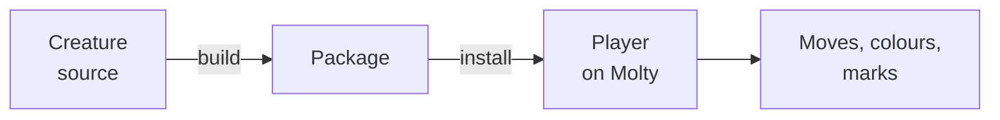

# Creatures

A creature package is one Molty: its body and everything it does, as data. The device plays it. This page is the
format of that data, for people who build creatures or work on the players. For what packages are and how they get on
a Molty, start with [Packages and scenes](PACKAGES.md).

The firmware has no duck, cat or octopus code. It has a player that knows channels, terms and a fixed list of factor
ops, and nothing about what they draw.



Each creature has a build script that writes its package with a shared kit. The package is one JSON file, at most
40 KB (a rigged creature: 256 KB). Two players read it: the reference one in JavaScript and its C port on the device.
They give bone transforms, colours and marks.

What ships, all three built into the firmware:

| creature | version | how it is made | how the device draws it | its own gestures |
|---|---|---|---|---|
| duck | 1.0.0 | channel layers (sections 1 to 8) | a body the fluid flows toward | none |
| octopus | 1.0.0 | channel layers | a body the fluid flows toward | none |
| cat | 2.2.0 | a Blender rig with baked clips and a life block (section 12) | crisp dots, straight on the panel's lattice | `eat`, `yarn`, `walk`, `shaken` |

The motion model of the channel creatures is the one the creature lab's animals were written in: a shared pose from the
mood engine and the gestures, then the creature's own layers on top. Every line of that code became a channel; nothing
was dropped on purpose (losses are listed in section 11).

## 1. The package

```jsonc
{ "v": "molty-pkg/1", "id": "duck", "name": "Duck", "version": "1.0.0", "kind": "creature",
  "creature": {
    "about":    { "look": "...", "gestures": { "<action>": "..." }, "moods": { "<mood>": "..." } },
    "body":     { "palette": {...}, "bones": [...], "parts": [...] },  // the lab's v2 rig (SPEC.md), unchanged
    "walk":     { "hz", "stride", "pace", "burst", "radial", "quad", "surge": [terms], "ch": [channels] },
    "groups":   { "<name>": { "bones": [ids], "attr": { "<k>": [one number per bone] } } },
    "events":   { "<name>": Event },
    "base":     [channels],
    "gestures": { "<action>": { "ch": [channels], "replace": true, "dur": 4.6 } },
    "moods":    { "<mood>": { "ch": [channels], "now": false } },
    "post":     [channels],
    "tints":    [Tint],
    "ambient":  Ambient } }
```

**About** is for the agent that speaks as this Molty, never for the player: `look`, 2 or 3 plain sentences on what a
person sees on the round screen (at most 240 characters), and one line for every gesture and every mood it plays,
`idle` included, on what that looks like on this animal (at most 100 characters each; printable ASCII).
The package check makes sure it is complete. The device sends it to the relay with the gestures and moods it plays
([the `creature` event](AGENT-LINK.md#device-events)), and agents get it as `device.creature`.

**Gestures** are named `[a-z][a-z0-9_]{0,23}`. A shared one (nod, wiggle, ...) plays over the
shared pose and keeps its length (no `dur`); any other name is the creature's **own** gesture and gives its length, `dur` 0.2..10 s
(the cat's `eat`). Every creature plays the shared ones; an agent's `act` plays one of its own too, and the device answers
`unknown_gesture` for a name the creature lacks. Its parts may exist only for it: the cat's bowl is a bone scaled from 0 to 1
by a channel (`bowl:s`, `op: "="`), like its tongue. That was the channel cat (1.x): the cat that ships is rigged
(section 12), with `eat`, `yarn`, `walk` and `shaken` as clips.

Bones may carry `sit` and `fold` (a leg's seated position and folded length, read by the kit's generators at build time),
`wave` (an arm joint's axis, joint and arm index, the same) and `d` (depth down its chain, for colour that ripples).

## 2. Channels and terms

A **channel** is a named number. Each frame it is the sum of its terms:

```
channel = [name, [term, ...], options?]
term    = [gain, factor, factor, ...]          value = gain × factor × factor × ...  (a zero ends the product early)
factor  = "@name"                               another channel's value
        | [op, source, param, ...]              an op applied to a source, see the table
```

- **name**: `pos.x` and the other pose fields write the shared pose; `bone:prop` writes a bone; `%name` is local to one
  group instance; `_name` is scratch; any other name (`duck.wl`, `earF.l`, `flush`) is the creature's own.
- **source**: `"a"` the block's own clock (seconds into the gesture, the mood or the event; the walk cycle in `walk`),
  `"@name"` a channel, `"$k"` the group instance's attribute (`$i` its index), `"~n"` the block's n-th random draw (0..1),
  or a number.
- **param**: a number; `[lo, hi]` drawn once per play; `[lo, hi, n]` drawn from slot n, so ranges with one slot move together
  (a gesture's frequency and twice it); `"D"` the block's length; `"$k"` an attribute; `{ "_": base, "<mood>": k, ... }`
  base plus k times that mood's weight (only in options).
- **modifier**: `abs:`, `pos:` (max 0), `neg:` (max of 0 and minus), `sq:` before an op (`["pos:sin", "@t", 4]`).

| op | params | value (x is the source) |
|---|---|---|
| `v` | | x |
| `sin` | hz, phase (rad) | sin(2π hz x + phase) |
| `nz` | hz, seed, offset | smooth value noise at hz x + offset, -1..1 |
| `env` | d, attack, release | ss(x / a) ss((d - x) / r) |
| `bump` | a, b | sin(π (x - a)/(b - a)) inside a..b, else 0 |
| `ss`, `ssd` | at, len | smoothstep((x - at)/len), and 1 minus it |
| `exp` | k, at | e^(-k max(0, x - at)) |
| `cyc` | hz, phase (cycles), up | a repeating rise over `up` of the cycle and smooth fall |
| `bumpr` | hz, phase, a, b | `bump` on the cycle fraction |
| `step` | hz, phase, d | a foot: -1 to 1 linearly over the stance d, back by a cosine |
| `frac` | hz, phase | the cycle fraction |
| `pulse` | hz, seed, width | beats near hz, each its own height, a little early or late |
| `dz` | hz, seed | noise with a dead zone: mostly still, now and then a decided move |
| `steps` | period, seed | holds a random value, snaps to a new one each period |
| `chance` | period, seed, p, offset | 1 for the periods whose hash is under p |
| `flap` | | an asymmetric beat on a phase in cycles: down fast, up slower |
| `lt`, `gt` | a | 1 when x < a (x > a), else 0 |
| `is` | a | 1 when round(x) = round(a) |
| `sgn` | | -1 under 0.5, else 1 (a side from a draw) |
| `lin` | a, b | a + b x |
| `clamp` | lo, hi | x clamped |
| `pow` | e | sign(x) abs(x)^e |
| `rcp` | a, b | 1 / (a + b x) |
| `asin` | | asin(x) |
| `fl` | k | floor(k x) |
| `dl` | seconds | the source channel's value that long ago (it needs `hist`) |

### Options

| option | effect |
|---|---|
| `op` | `+` (default) adds; `max` keeps the larger (lids, mouths); `*` multiplies by (1 + value); `=` sets |
| `cl` | [lo, hi]: clamp the value |
| `int` | integrate the value over time (a phase in cycles, a breath) |
| `lp` | low-pass at this rate (1/s; may be a mood mix) |
| `sp` | [k, c]: a spring toward the value (4 substeps); with `lag` the output is spring minus value (follow-through) |
| `d` | [lo, hi]: the rate of change per second, clamped (how fast it is turning) |
| `hist` | seconds of history kept for `dl` (at most 1) |
| `keep` | the value survives into the next frame until the channel runs again (read early by an event's gate) |

A stateful channel (`int lp sp d`) sets by default. Its state is its own; the value is what it writes.

## 3. Inputs

Every frame starts with every channel at 0 except: the shared pose (`pos.x/y/z rot.x/y/z head.x/y/z spine.x/y/z squash lid
mouth look.x/y prowl`), `t` and `dt`, `act` (1 while a gesture plays), `work` (1 while the agent is working: mood `working`), the walk (`walk.q k go along side fz up`), per mood
`is.<m>` (1 or 0), `w.<m>` (weight, eased at 4/s), `w6.<m>` (eased at 6/s), `now.<m>` (1 at once when it comes, the
weight as it leaves), `m.<m>` (seconds since it last came), the eye word `eye.wide/happy/sleepy/squint`, and `keep` channels.
Moods are `idle listening thinking speaking happy sleepy surprised`.

## 4. Layers, in play order

1. **walk** `ch`, clock = the walk cycle. `surge` (terms over `walk.q`) is how much ground a burst covers at that point.
2. **events**: each a scheduler. `first` (s), then `gap` [lo, hi] after each one ends, or `rate` (starts per second, times
   the gate). It starts when `gate` (terms) is over 0.5, plays `len` (a range is drawn) and ends early when `stop` is over 0.5.
   With `pick`, one member is chosen at random each time; members have their own `len`. Outputs are scaled by `w` (terms).
3. **base** channels, every frame.
4. **gestures**: the current one at weight 1 and the one fading out (the mood engine's crossfade). `replace` (default) first
   removes the shared gesture's own offset, so the creature does it its own way. Clock = seconds into it, `D` its length.
5. **moods**: each at its weight `w.<m>` (or `now.<m>` with `now: true`) while over 0.01. Clock = seconds since it came.
6. **post**: the last word on the pose (follow-through, smoothing, damping), then the bones.

Draws (`~n`, ranges) are new each time a block plays: each gesture play, each time a mood comes, each event. A block's
weight scales what it writes to the pose and own channels; scratch, locals and stateful channels are never weighted.

### Waiting on the agent

Each package carries a `ponder` event (from the kit): gated on `is.thinking` and `work`, it picks one small expression
every 2 to 5 s: a glance aside, a head tilt, a double blink, a look up, a little yawn once it has thought 14 s, and the
animal's own (the cat's ear flick and tail swish, the duck's ruffle and nibble, the octopus's passing cloud and curl). The
firmware chooses nothing: while a package creature is on screen, `working` hands it no work actions (`fd_set_own_work`).

## 5. Bones

`bone:prop` adds to a bone reset to its rest pose this frame. `rx ry rz` (rad) and `px py pz` add; `sx sy sz s` multiply by
(1 + value), or set with `op: "="`; `sq` squashes keeping volume (y × (1 + v), x and z × 1/√(1 + v)). `root` is the whole body.
Several channels on one output combine (sums, products).

A **group** runs its channels once per bone: `{ "each": "arms", "ch": [...] }`, where `:rx` is that bone, `%c` a local and
`$ax` that bone's attribute. The octopus's 32 arm joints are one list of 9 channels and 24 attributes.

## 6. Colour and the glass

**Tints**: `{ ch, to: { paletteName: "#hex" }, neg: {...}, wave: [hz, lag per depth, k] }`. A palette colour moves toward
`to` by the channel (toward `neg` when negative). With `wave` the amount ripples down the body by bone depth `d`:
k v max(0, sin(2π (hz t - lag d)))². Only the named palette entries change (the octopus's skin, never its eyes).

**Ambient**: particles and a current, around the body. The body is the creature's own coverage this frame, so particles
pass behind it.
- `kinds`: `bubble` (rises at `rise` [base, per size, random], speeds up by `acc`, wobbles, pops at the glass edge `glass`
  into a star with `pop` [time, colour, size over which it splashes, strength, radius]); `blot` (an ink clump of `pts`
  blobs that blooms, sinks, turns and fades over `life`).
- `emit`: `{ p: kind, at: floor|side|top|bottom|center, every: [lo, hi] | on: channel (when it rises past 0.5) |
  rate: [channel, per second, min], n, dx, dy, r, rp (size skew), stack, stagger, twin, impulse: [strength, radius] }`.
- `motes`: a fixed drift of `n` specks. `current`: four channels (x, y, vx, vy) pushed into the fluid each frame.
At most 64 live particles.

## 7. Limits

For a channel creature (the rigged cat's limits are in section 12):

| | limit | duck / octopus |
|---|---|---|
| file | 40 KB | 30.5 / 33.0 KB |
| bones, parts | 96, 96 | 13, 18 / 37, 45 |
| channels (all blocks) | 512 | 345 / 260 |
| terms, factors | 1024, 2048 | 496, 842 / 347, 507 |
| factors in one term | 8 | |
| group instances, attributes | 64, 32 | octopus 32 × 25 |
| events | 16 | 8 / 5 |
| history | 1 s per channel | |
| live particles | 64 | |

## 8. Cost on the device

Per frame the player evaluates the base, walk, post, the running events, at most two gestures and the moods in weight.
Measured with the reference player over two minutes of every mood and gesture:
worst frame 390 / 1170 factor evaluations, mean 306 / 1085 (duck / octopus).

In C on the ESP32-S3 (240 MHz, single-precision FPU), a factor is a switch dispatch, a few loads and its maths: about 20
cycles for sin from a table, 40 for noise (two integer hashes and a smoothstep), 60 for `exp`; 40 on average with the term
and channel loop around it. The octopus's worst frame is then about 46 k cycles, **0.2 ms of a 33 ms frame** (0.5 ms if it
were 100 cycles a factor). The compiled program (24 bytes a factor, 8 a term, 16 a channel, 4 an attribute) is about
29 / 22 KB (duck / octopus): internal RAM or PSRAM, either is fine. Bones, colour and particles cost what the renderer already spends.

The C port must match the JS player's semantics, including the hash: murmur3 fmix32 of floor(16 n), so the same package
draws the same numbers on both.

**As built** (the C player): channel values are float; the clocks (time, mood clocks, a block's clock,
integrated phases) and the hash's argument are double, and the periodic ops (`sin nz frac cyc bumpr step pulse dz steps chance
flap`) form their argument in double, so a creature moves the same after a day on as after a minute. It is built without fused
multiply-adds (`-ffp-contract=off`): a hash's argument must round as JS rounds it. Against the JS player's goldens it agrees to
1e-6 on the pose and 1e-4 on the bones, with every draw and every ambient particle the same. On the host the player is 2 to
10 µs a frame; the body's raster (2 to 3 thousand facets of the lab's 14×10 ellipsoids, a coarser mesh for an ellipsoid whose
facets are under a sample while the camera is not zoomed) is most of the creature's cost.

## 9. 2D sprites

They stay a **lab-only render** and are not part of the format. The device draws the rig (bones and parts) into the fluid,
so the rig is the one thing a package has to carry. The lab's sprites are a second, hand-drawn
renderer per animal (its own drawing code for wings, ears and arms), so carrying them would mean a second body format and a
second set of channel bindings for each creature, for a view the device does not show.

## 10. Building and checking

```sh
node packages/duck/build.mjs        # writes packages/duck/duck.json and its packages/index.json entry
node --test tools/creatures/*.test.mjs   # the player's rules, and every creature package plays clean within its limits
```

The kit holds the body helpers (the lab's) and the generators for the layers every Molty shares: the
fidgets (`alive`), the living layer (`living`: pose onto root, torso and head, wings, ears, tails with follow-through,
legs, arm ripples, feet, eyes, mouth) and the blink and breath motions. A package calls them at build time, so the result
is plain data in its own file; another creature can tune or drop any of it.

## 11. Fidelity: what the data version loses

Compared over the full reels (every scene, mood and gesture) against the approved clips:

- **Randomness differs in detail, not in kind.** The hash is new (an integer hash the C side can match), so blink timing,
  idle events, the octopus's wandering arm and every per-play draw land on different values than the code version.
- **Living layer ears**: the head's spring follow-through no longer feels the body's vertical speed (a small term).
- **Cat's held tail** (tail up, tail wrapped): the lab bends the chain toward set directions from wherever it is each
  frame; the package carries rotations solved at build time for the cat sitting, standing and arched, blended by those
  channels. Close sitting, happy and loafed. Arched (surprised) it stands straighter and taller than the code's hooked
  bottle brush, the one difference that shows in the reel.
- **Cat's stalk**: the leg lift while planted uses a two-term series for 1 - 1/cos(asin x) (under 0.1% off).
- **Duck's waddle swing**: the foot's return uses a cosine where the code used a smoothstep (under 2% of the stride).
- **Octopus pointing**: an arm lifts when the glance points its way by the glance's amount, not past a threshold, so it
  rises smoothly instead of switching on.
- **Octopus breath bubbles** come at the breath's average rate instead of on each breath's peak.
- **The duck's idle "quiet" gate** is read before the creature's own gestures and moods add to the pose this frame, so a
  pose that tips the head far forward may start an idle event a frame early.
- **The octopus's surprised clock** runs from the last time it was surprised, so leaving the mood early lets its sharp
  moments run on as the weight fades (the code froze them at their settled values). In the reel it stays pale a beat
  longer after a fright.
- **2D sprites**: not carried (section 9).

## 12. Rigged creatures (clips, routes, dots)

A creature package may carry a **rig** instead of channel layers: a skeleton, its body as rounded primitives per bone, baked
clips, and the route map between its poses. The cat (2.2.0) is the first: modelled, rigged and animated in Blender, every clip baked, with an authored transition between every pair of resting poses. Its source is the folder `moltys/cat/`, and [The Molty format](CREATURE.md) is how one is made. Its channel layers stay empty; `gestures` and `moods` only declare what it plays (and their
lengths for the mood engine), so agents and the console see the same names as for any creature. It has its own reference player in JavaScript and a
C port on the device.

```jsonc
"rig": {
  "fps": 24,
  "scale": { "t": 4096, "r": 32767, "s": 4096 },         // int16 quantisation of the clip outputs
  "nodes": [ { "id": "root", "parent": -1, "t": [x, y, z], "r": [x, y, z, w], "s": [x, y, z] }, ... ],   // rest pose, parent first
  "shapes": [ Shape, ... ],                                // the body, on the nodes, in their rest frames
  "contacts": [ [node, [x, y, z]], ... ],                  // the paws' contact points (the light paw lock)
  "palette": { "body": "#a99be8", ... },
  "clips": { "<name>": Clip, ... },
  "graph": Graph }
```

**Coordinates.** y up, the creature faces +z, its left is +x; one unit is the body's (the cat stands about 0.6 high).
A node's `t r s` are relative to its parent (glTF's node transform).

**Clip** (glTF 2.0's animation layout, per clip):
`{ dur, loop, from, to, view, follow, frames, ch: [ [node, path, interp, bytes, in, out], ... ] }`: each channel a glTF channel
and its sampler in a compact array: `path` "t" | "r" | "s", `interp` "S" | "L" | "C" (STEP, LINEAR, CUBICSPLINE), `bytes` 1 or 2
per output component.
- `in`: base64, the key frames (at `fps`): u8 in a clip under 256 frames, else little-endian u16. `out`: base64 int16 (2 bytes, divided by `scale[path]`) or int8
  (1 byte, rotations only, normalised: divided by 127), glTF's KHR_mesh_quantization. LINEAR: a value a key
  (rotations take the shorter way and are normalised); CUBICSPLINE: in-tangent, value, out-tangent a key (glTF's order),
  the tangents per frame; STEP: one value. A channel that is the rest pose all through is left out.
- A loop's last key interpolates to frame `frames` (its first key again), so it closes smoothly.
- `from`, `to`: the pose families it starts and ends in. `view`: the camera's yaw for it in degrees (0 in front, -90 from the
  creature's right). Root motion is the root node's translation: it carries on from clip to clip.
- Keys come from the posed Blender rig (IK solved, so plain FK), reduced greedily while the curve stays within 0.003
  (translation), 0.0045 (the quaternions of the chains from the root to the paws: a planted paw sums their errors),
  0.008 (other quaternions), 0.02 (the int8 tail, ears and face), 0.02 (scale; 0.05 for eyelids and mouth) of every
  sample; each channel takes LINEAR or CUBICSPLINE, whichever is smaller.

**Shape** `{ k, b, g, c, p, ... }`: `k` the kind, `b` the node, `g` the outline group, `c` a palette name, `p` its centre:
- `blob` (`q`, `r` radii, `st` stiffness): one element of the merged body: a metaball field st (1 - q)^3, threshold 0.6
  (Blender's), so the back, rump and legs are one smooth shape in every pose;
- `ell` (`q`, `r`): an ellipsoid (head, paws, eyes as flat discs, nose, mouth, tongue, props);
- `cap` (`p1`, `r` [r0, r1]): a tapered capsule (front legs, tail, whiskers); `cyl` the same with flat ends (a bowl);
- `cone` (`p1`, `r` [radius, flatness], `fa` the flat axis): an ear;
- `patch` (`q`, `r`): a region of the body's surface (the white chest): colour only, never a shape.
Groups: `torso hindL hindR head legF.L legF.R tail bowl yarn` outline; `eye earIn nose maw tongue whisker chest milk`
are features.

**Graph**:
`{ families: [...], rest: { family: loop }, edges: { "a>b": clip }, moods: { mood: clip }, gestures: { name: clip },
hold: { gesture: seconds }, enter: { clip: { family: clip } }, sync: { loop: stride seconds },
chains: { gesture: { first: [clip], then: [clip], rounds: [min, max], last: [clip] } }, blend, center: [node, node] }`
(`first` and `last` may be left out; a chained gesture's own entry in `gestures` names its first clip).

### Playing

- The player keeps a **target**: the mood's loop, or a gesture's clip once (a `hold` gesture, the walk, stays in its loop
  that long). To reach it from the family the current clip ends in, it plays the **route**: the authored edge clips, found
  breadth first (`edges` in file order), then the target. `enter` gives a target its own way in from a family (the cat's
  startle from sitting or standing). Between two clips it crossfades for `blend` seconds (eased; quaternions nlerp), and a
  **light paw lock** holds the paws that were on the floor where they were, fading out with the blend.
- Every ordered pair of resting families has its own authored clip, and so do sitting and standing into and out of the walk
  (the cat: sit, stand, loaf, crouch, walk; 16 clips); from the loaf or the crouch the walk is two authored hops (it stands up
  first). A crossfade only ever joins clips of the same family (a mood to a mood while sitting, a transition into its loop).
- A loop in `sync` (the walk) is joined at the phase that best matches the pose on screen and left only on a stride
  boundary, so a stepping paw is never cut.
- A gesture or mood name the package lacks is refused (`unknown_gesture`), as for channel creatures.
- **Chains.** A gesture in `chains` plays one clip of `first`, then `rounds` (a count drawn between min and max) clips of
  `then`, never the same one twice running, then one of `last`; then it routes back to its mood as any gesture does. Each
  pick is a draw from the creature's seed (`cc_seed`: the same seed as the life's), so the same seed plays the same game
  and two boots differ. A chain's clips join without a crossfade: the tools check that each starts in the pose the one
  before ends in (the body, and each prop where it was from the root).
- **The heading carries** between clips as the place does: a clip that turns its root about up (a turn on its feet)
  leaves the creature facing that way, and the next clip, whatever it is, starts from there (`oyaw`, turning the root and
  the props about up through the origin before `ox, oz`). No clip before the cat 2.2.0 turns its root, so they play as
  they did.
- **Called to the front.** A tap on the screen (not on a control: a question's answer) or a shake calls a rigged
  creature (`cc_come`): it walks to the front of the frame facing the viewer and sits up attending (its `listening`
  clip, 3 s), then goes back to its mood. Already facing front near the middle, it only perks up. A shake plays its `shaken` clip first. A gesture ends the call.

The cat's clips, by what they are for:

| for | clips |
|---|---|
| moods | `idle`, `listening`, `thinking`, `speaking`, `happy` (sitting), `sleepy` (the loaf), `surprised` (standing, arched) |
| shared gestures | `wiggle`, `nod`, `shake_head`, `bounce`, `peek` (also `inspect`), `glance_left`, `glance_right`, `blink`, `wobble`, `stretch`, `look_up`, `yawn`, `paddle` |
| its own gestures | `eat` (a chain: the bowl comes in `eat_left` or `eat_right`, then `eat_dish`), `yarn` (a chain: `yarn_in`, 1 to 4 of `yarn_bat_l` and `yarn_bat_r`, then `yarn_away`), `walk` (held 6 s), `shaken` (3.4 s) |
| resting loops | `idle` (sit), `stand_idle`, `loaf_idle`, `crouch_idle`, `walk` |
| transitions | 16 edges: every ordered pair of sit, stand, loaf and crouch, plus sit and stand into and out of the walk |

### Life

A rigged creature may carry `life` (written as a readable block in its Molty folder, [The Molty format](CREATURE.md),
"Life"; the Molty tools check it and compile it into this). Without it the creature plays exactly as it did before life
existed (the creature test pins the duck, the octopus and the cat 2.0.0 frame for frame).

```jsonc
"life": {
  "ch": [ Channel, ... ],              // its signals: channels of the engine above (section 2), each after what it reads
  "events": { "<name>": Event, ... },  // hold and every: events (section 4) that never stop by themselves (gap 0)
  "layers": [ { "by": "breath", "w": "_lw.gaze", "clip": "breath", "zero": 0.5, "nodes": [9, 10] },   // a pose clip
              { "by": "breath", "nodes": [1], "rot": [0, 0, 5], "sq": 0.04 } ] }                     // bones turned
```

- **Each frame** (on the fluid task, before the clips): the device sets `free` (1 while only the mood plays: no gesture,
  call, way between poses or walk), `idle_time` (seconds since anyone did anything) and `life` (the owner's idle-life
  setting: 1, 0.5, 0); the player runs its events, then its channels; each layer reads its `by` and `w` (weight, 1 when
  left out). Old firmware refuses `life` ("creature: unknown key"): a Molty with one needs this firmware.
- **Randomness**: the life's draws and its events' gaps take the creature's seed (a new one each boot on the device, a
  fixed one in the tests and the rig), so the same seed plays the same frames and two boots differ.
- **Layers** are added over the clips' pose, in order, at most 8 a frame (those with a weight over 0.01). A clip layer
  samples its clip at `u` (by from 0 to 1 maps `zero` to the clip's end, by from -1 to 0 its start to `zero`) and adds the
  difference from the clip at `zero`: moves added, turns turned on in the bone's own frame (by the weight's share), sizes
  multiplied; only its `nodes` (all when left out), and only channels that move. A turn layer turns its `nodes` by
  `rot` degrees a unit of `by` (as a bone's turn) and stretches them by `sq` a unit (up, thinner across). The clips'
  own pose stays apart, so a crossfade never starts from a layered pose.

### Drawing (the device's look)

Both players draw straight onto the braille lattice (2W x 4H dots), no meshes: each primitive is
projected orthographically (the camera eases round to the clip's `view` at 2/s and follows the body at 3/s), the merged body
as a 2D metaball field with the nearest surface's depth per dot, the parts as solid ellipses and capsules. Then: one
outline, inner lines where a nearer group crosses another (a hind leg only along its lower front edge against the body),
brighter where nearer; the features; whiskers where nothing else is drawn; and the world: a static perspective floor (a dotted
texture fixed in the world and receding lines every 26 dots, so the creature walks over it), shimmering dust that thickens
toward the horizon, a vignette, and a two-dot halo kept clear round the creature. A cell takes one colour: the creature's
dots win a cell, then the brightest. On the device the cells go to the fluid's drawer as a scene's dots (crisp on black),
with the fluid held still under them.

**Rings over it.** The recording ring, a
question's arcs and the progress ring show over the crisp cells in one language: a wave runs out from the centre
through the real water (the creature wobbles as it passes), its crest takes the ring's colour near the rim and lands
there as a thin sharp line, in about 1 s. While a listen records, the voice sends small ripples from the rim inward,
more and stronger the louder. Letting go, a wave runs in from the rim and fades. The recording ring is red
(`#ff2c3e`) unless the agent (`ring_color`) or the owner's setting gave it a colour.

### The sky

Behind a rigged creature, in its world (`main/creature/sky.c`, merged by `creature_dots.c` `cd_sky`): today's moon,
small, up and to the right of the creature, and now and then a falling star. Both are braille dots of the world, so the
creature is always in front (a cell with its dots keeps only them, its halo keeps the sky off it), a touch's wave
loosens them and they settle back as the world's dust does, and a change of picture takes them with the creature's
picture.

- **The moon.** Lit to the real phase as seen from the northern hemisphere (waxing: the right side), from the date
  (Meeus, *Astronomical Algorithms*, ch. 47, the main terms: the moment of a full or new moon within minutes, the
  distance within a few hundred km). A new moon shows nothing. Its size follows its real distance, exaggerated so the
  eye sees it: 70 % of the options page's "A sky" at the farthest (406,000 km), 75 % on an average night (384,400 km),
  100 % at the nearest (357,000 km), in whole dots (7 to 10 dots across its radius on the 466 px panel). A supermoon is
  the full moon on a big night. Its face is a 32 x 32 grey map of the near side (512 bytes,
  `sky_moon_map.h`, made by `tools/scripts/sky-moon-map.mjs` from the astrology globe's moon), one colour a cell, at
  the "quiet" brightness: its brightest dots about luma 100, the cat's eyes about 205. Made once a day (the phase and
  distance at noon UTC) and kept: a frame only merges its cells.
- **The falling star.** One every 4 to 15 minutes of the creature on the glass, at random (its own seed, from the
  director's: repeatable in tests, new each boot); the wait counts only while one may show. A streak of 0.35 to 0.6 s
  from the upper sky down at a slant, left or right of the cat and clear of the moon, never the last path again; its
  trail fades behind the head and is gone 0.6 s after it. At most 96 dots; its head at luma about 190, under the eyes.
  Never while a question, a listen, a say, a speaking mood, the progress ring, a change of picture or the bench is up,
  nor while the creature sleeps with do not disturb on (the one bright thing moving in a dark room).
- **The date.** Network time (SNTP, `CONFIG_MOLTY_SNTP_SERVER`, `pool.ntp.org`) once Wi-Fi has an address, again every
  hour; the chip's clock keeps it through a soft restart, never written to flash. `GET /api/diag` reports it (`time`).
  Until it is known there is no sky. The web module takes it from the page (`wm_time`); the fidelity script gives
  none, so its frames have no sky, and `sky.script` plays one with a date.
- **The setting.** `sky` (`POST /api/creature/state {sky: false}`, on out of the box, kept in NVS once the screen is
  calm), the console's Settings > Molty "sky". A southern view (the lit side mirrored) would be one more setting and a
  sign on the light's side; not there yet.

Cost: the moon is made once a day (well under a millisecond); a frame merges at most a few hundred dots on the sim task
after the creature's cells (host: under a microsecond with a star running).

### The weather

Rain on the glass behind a rigged creature, in its world as the sky is (`main/creature/weather.c`, merged by
`creature_dots.c` after the sky): it goes with the creature's picture, never over a scene, a question, words or the
screen off. It is told, never guessed: a kind and how long it holds (`POST /api/creature/state {"weather": {"kind":
"rain", "s": 3600}}`, or a kind's name alone for an hour; 10 s to 6 h), kept in RAM only. When the time is up it eases
back to clear by itself, so a Molty whose agent went away does not rain for ever. GET reports `weather {kind, s_left,
level, wet}`. Nothing told: clear, nothing made or drawn, no random number drawn (the frames are those of a Molty
without weather).

- **The kinds.** Drizzle, rain, downpour, from the rain options page (A, B, C), thinned to fit the frame: a drop that
  lands is one soft bump in the real water (strength 0.12, a light tap's 0.15 x 0.8), so its rings are the water's own
  and a touch's wave and the drops live in the same water; a thin ring oval and a two-dot splash are drawn where it
  lands. Streaks are dotted lines on the dot lattice, near ones long, fast and bright, far ones short and dim, at 3
  (drizzle), 8 (rain) and 21 (downpour) degrees; they fall behind the cat (its halo keeps them off it). A streak moves
  every third frame and a ring grows every other, in turns: what costs is the panel's cells that change.

  | | lands / s | far streaks / s | in front / s | bumps / s | drops on the glass |
  |---|---|---|---|---|---|
  | drizzle | 5 | 10 | 0 | 5 | 5 |
  | rain | 10 | 26 | 0 | 10 | 10 |
  | downpour | 8 | 8 | 10 | 4.8 (60 %) | 12 |

  At most 3 bumps a frame, 144 streaks, 48 rings, 16 drops on the glass; the rain's brightest dot about luma 150
  against the eyes' 205.
- **The downpour** is slanted and long, and also falls in front of the cat (from over its head, slower, most of it
  across the cat): across its body a dot in four left out and at 0.55 of the brightness, never on its own lines nor
  near its eyes. Now and then the cat shakes itself off with its own
  `shaken`: 25 to 60 s into a full downpour, then every 3 to 7 minutes, only when nothing else plays (no gesture, mood,
  listen, say, question, ring, change of picture, and awake).
- **Drops on the glass.** A few sit on the glass and fade after 25 to 70 s; now and then a big one away from the cat's
  column runs down with a trail of specks. A drop is a lens, not a bubble: a point of light up and to the left, the rim
  lit low, nothing at its top. Never over the face.
- **Moonlit.** Drizzle and rain under a bright moon show only in the moon's light (a soft beam from the moon down to
  the floor, with more far streaks in it): the look blends in with the moon's lit fraction from 0.35 to 0.85, so a thin
  or new moon gives plain rain; so do the sky off, no date, and a downpour.
- **Starts and ends.** The level moves a kind every 6 s: rain starts and ends through drizzle, nothing pops.
- **The wet floor.** It wets over 90 s of rain and dries over 15 minutes after it, in patches: a fixed puddle map in
  perspective (the low places wet first and dry last), a cell a quarter step at a time, so a few cells change a frame.
  Where it is wet the floor is darker and mirrors the cat (its own dots of the frame, flipped under its feet, squashed to
  0.55, fading out a quarter of the glass below) and the moon (flipped about the horizon), both pushed by the water's
  slope and broken where it is steep (a drop's ring, a touch). Dry: today's floor exactly. The lifetime and the drying go
  by the clock, the screen's time off included.
- **The setting.** `weather_on` (`POST /api/creature/state {weather_on: false}`, on out of the box, kept in NVS once
  the screen is calm), the console's Settings > Molty "weather", next to a "try the weather" row (a kind for 5 minutes).
  Telling the weather alone is not someone driving: it neither wakes the creature nor changes its life.
- **The web module.** `wm_weather(kind, s)`; `weather-drizzle`, `-rain` and `-downpour.script` pin the looks (checked
  native against WebAssembly). The site's /demo/ page has the controls; the home page's cat stays clear.

Cost, modelled in the web module's device mode (the panel's measured costs, a mean over 100 s with the cat's own life):
the drawer's work a frame from 18.8 ms with no weather to 23.1 (drizzle), 27.4 (rain, 24.9 moonlit) and 29.5 ms
(downpour), a frame 30.3, 30.9, 31.7 and 32.5 ms (the 30 ms floor; about 31 fps at the worst); the cat's own gestures
still make the longest frames. On the sim task the weather itself
is about 2 us a frame on a computer (about 0.2 ms on the device) plus its merge, a few hundred dots. Its memory: one
25 KB block in PSRAM, made at start.

### Limits and cost

| | limit | the cat |
|---|---|---|
| file (rigged) | 256 KB | 255 KB |
| nodes, shapes, clips | 80, 128, 64 | 43 (2 of them props), 109, 54 (4 of them pose clips for its life, 7 links of its eat and yarn chains) |
| families, edges, gestures, chains | 8, 64, 32, 4 (8 clips a step) | 5, 16, 18, 2 |
| channels (all clips) | | 2046 (1368 LINEAR, 678 STEP, no CUBICSPLINE) |
| life: channels, events, layers; engine steps a frame | 256, 16, 16 (8 played a frame); 600 | 16, 3, 6; 44 |

Per frame on the device: sampling (a binary search and a Hermite per channel, ~100 channels) and FK of ~50 nodes are a few
µs; the dots are the cost: the field and parts over the creature's box, then a hash per dot for the world.
Measured on the host (Apple silicon) and scaled by the creature test's own
calibration (about 54 µs on the host for 11 ms measured on the 1.46): the cat's play + dots cost about 8 to 10 ms
sitting or lying, 12 to 13 ms standing, crouched or eating, 17 to 18 ms walking (side on, the widest box), on the 1.46's
52 x 32 grid. The fluid under it is held still (no background, swirl or view), so a frame is that plus the sim steps, the
drawer and the flush. To be confirmed on the device (`GET /api/creature/state`, `prof_ms.c_update`). Its life (44 engine
steps, six layers over about 40 channels) adds about 0.15 ms a frame by the same calibration.

## Where this lives

| What | Where in the repository |
|---|---|
| The creature packages and their build scripts | `packages/duck/`, `packages/cat/`, `packages/octopus/` |
| The cat's Blender sources | `moltys/cat/` (`cat.blend`, exported by `tools/blender/molty_export.py`) |
| The shared kit and the player tests | `tools/creatures/` |
| Reference players (JavaScript) | `device/creatures/js/creature-player.js`, `clip-player.js`, `clip-dots.js` |
| Players on the device (C) | `device/firmware/main/creature/` |
| Host tests and goldens | `device/firmware/test/host/` |
| The package check | `packages/tools/format.mjs` |
