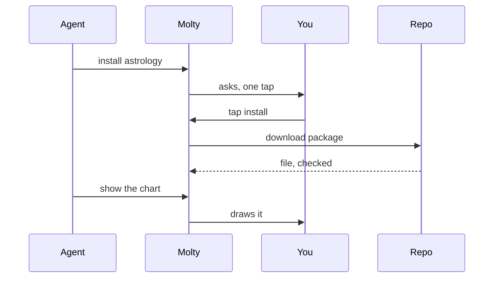

# Packages

A package gives Molty something new to show. It is one of two things:

- **A creature.** A new animal to be, with its own moods and moves.
- **A set of scenes.** Drawings your agent can put on the screen, such as a star chart.

A package is data, never code: it cannot run anything on your Molty. Molty knows how to play packages, not what any
of them are about. It has no idea what a planet, a zodiac sign or a cat is.

## What ships today

| Package | What it is | Version | Size | On a new Molty |
|---|---|---|---|---|
| Cat | a creature | 2.0.0 | 242 KB | already there |
| Duck | a creature | 1.0.0 | 31 KB | already there |
| Octopus | a creature | 1.0.0 | 33 KB | already there |
| Astrology | scenes: the moon, the planets, the zodiac chart, eclipses | 1.7.1 | 73 KB | your agent installs it |

## Installing takes one tap

Your agent can ask Molty to install a package. Molty never does it on its own.



1. Molty asks you on its screen, by name: `INSTALL ASTROLOGY?`
2. You tap `install` or `not now`. No tap within a minute counts as no.
3. Molty downloads the package itself from the project's repository and checks it is the right file (its SHA-256).
   A line grows around the rim while it arrives.

A package stays on your Molty until it is removed.

## Showing a scene

The simplest way is a skill that knows the package. For the sky that is `molty-astro`: your agent runs one command,
and the skill works out where the moon and the planets really are and sends the scenes.

```sh
astro.mjs tonight      # the moon, the planets, then the moon's sign
astro.mjs chart        # the zodiac chart; tap a planet, a sign or a line to read it
```

Under it, a scene is one small command: the package, the drawing and a few values. Molty does the drawing.

To write your own scenes, start at [Draw on Molty](DISPLAY.md). To make a creature, start at [The Molty format](CREATURE.md).

```
scene.play {"pkg": "astrology", "layout": "sign", "params": {"sign": "leo"}}
```

When the scene ends, your creature comes back. Writing your own client instead of using a skill:
[the request itself](#writing-your-own-client) is at the end of this page.

## At a glance

| What | Rule |
|---|---|
| File | one JSON file, data only, at most 256 KB |
| Kinds | `scenes` (drawings an agent plays) and `creature` (a Molty) |
| On the device | at most 32 packages and 1 MB in all |
| Install | the agent sends `pkg.install`, the owner taps `install` on the screen, Molty downloads the file and checks its SHA-256 |
| Play | `scene.play` with a few params; a scene stays 60 s unless `ttl_s` says more (600 at most) |
| Device caps | `pkg` (needs touch), `scene`, `creatures` |

## 1. The package file

One JSON file, at most **256 KB**, built from its sources by the package's own build script.
The package index lists every package: `{ "<id>": { "name", "version", "kind", "description", "layouts"?, "skills"?, "path", "size", "sha256" } }`.
`description` is one line on what it adds, for an agent to pitch it to its human; a scenes package lists its `layouts`
and the `skills` that play it. A check validates every package and the index (size, hash, schema, every reference resolves).

```jsonc
{
  "v": "molty-pkg/1",
  "id": "astrology",              // [a-z0-9-]{1,32}; the file name and the install id
  "name": "Astrology",            // shown in the install prompt and the console
  "version": "1.5.0",             // [0-9A-Za-z.-], at most 15 characters
  "kind": "scenes",               // "scenes" or "creature"
  "assets": { "<name>": Asset },  // images and glyphs, drawn once, used by name
  "layouts": { "<name>": Layout },// scenes (kind "scenes")
  "creature": { ... }             // kind "creature": the creature team's format (section 5)
}
```

### Assets

```jsonc
{ "kind": "mask",  "w": 16, "h": 16, "bits": "<base64, 1 bit per pixel, rows top to bottom, MSB first>" }
{ "kind": "image", "w": 48, "h": 48, "px": "<base64, 4 bits per pixel, index into palette>", "palette": ["#rrggbb", ... up to 16] }
```
A mask takes the colour of the item that draws it. An image keeps its palette. Index 0 of an image is transparent.

### Layouts

A layout is a timeline of items:

```jsonc
{ "dur": 6,                                   // seconds; 0 = until replaced or its ttl ends
  "caption_y": 0,                              // optional: where the reading's words show (glass y, -1..1; default -0.56, the bottom)
  "params": { "bodies": "list", "title": "text", "lit": "number" },   // what the agent may send, with types
  "items": [ Item, ... ] }
```

Every item has `k` (kind), optional `on`/`off` (seconds into the layout, for builds and reveals), `color` (#rrggbb),
and geometry in **glass units**: the round window has radius 1, `x` right, `y` up, angles in degrees, 0 = right, counter-clockwise.

| k | fields | draws |
|---|---|---|
| `ring` | `x`, `y`, `r`, `w` | a circle outline |
| `arc` | `x`, `y`, `r`, `w`, `a0`, `a1` | part of a circle |
| `ticks` | `r`, `len`, `n`, `a0` | n evenly spaced radial marks |
| `line` | `pts: [[x,y],...]` | a polyline |
| `curve` | `pts` | a smooth curve through the points |
| `disc` | `x`, `y`, `r` | a filled circle |
| `ball` | `x`, `y`, `r`, `img`, `lit` (0..1 lit fraction), `side` (-1/1 which side is lit), `spin` | a shaded sphere wearing an image asset |
| `glyph` | `x`, `y`, `size`, `asset`, `rot` | a mask or image asset |
| `text` | `x`, `y`, `size`, `str` | words, in the device font |
| `spot` | `x`, `y`, `r`, `say`, `id`, `pts`, `lights`, `grow`, `arc`, `r0`, `r1`, `open`, `ttl` | nothing: a place to tap. Molty shows `say` as the subtitle; the `tap` event names `id` |

**Spots** make a scene interactive with no round trip: the agent sends each spot's reading with the scene
(`{ "k": "spot", "each": "$bodies", "polar": ["@a", "@r"], "r": 0.09, "say": "@say", "id": "@id" }`), and a tap on it
shows that reading at once, word by word at reading pace. The agent also gets the `tap` event with `spot: <id>`, to say
more if it wants. A spot takes the tap whatever tap is bound to (a tap that stops a recording still does that first).
A spot is a disc (`x`, `y`, `r`), or the band within `r` of a segment when it has `pts` (two points: a line to tap along).
It may also be tapped over a **ring sector** about the glass centre: `arc` degrees wide, centred on the spot's own
direction (the angle of `x`, `y`), from radius `r0` (0 unless given) to `r1`: a block of a dial (the chart's signs:
`"arc": 30, "r0": 0.75, "r1": 0.9`). The sector only widens where a tap lands; what the tap highlights is still the disc's.
What a tap highlights grows with the tap's wave (the spot's `grow`, 1..3, default 1.25: the chart's signs 1.5), stays so
while the reading (or the agent's say over the scene) plays, then eases back. On the device it stays perfectly still and
crisp meanwhile (the water breaks nothing it covers), and the wave leaves its outline rather than the finger. A spot is
a button: every bump its tap makes is 0.3 of a touch on open water. What it highlights:
- with `lights` (group names, spaces between, at most 4): every item whose `group` is one of them, each about its own
  centre and brighter; an item with `"when": "lit"` shows only then, fading in and out with it. Any drawn item may take
  `group` (a name, bindable: `"group": "@id"`) and `when`. The chart's aspects: a spot along each line lights the
  line's group and its two bodies'; the lit-only items reach the line out to them with a ring round each.
- without: what is drawn inside its disc (a symbol's centre in it; a ring, a line or ticks wholly in it), about the
  spot's centre.
A spot may **open another layout** of its package instead of reading: `"open": "<layout>"` (v2: a tap zone's
`opens`). Molty plays that layout at once, over this one (the picture changes as any scene's does: its dust lets go
of the old drawing and gathers into the new one), then shows the tapped spot's `say` over it, word by word, as that
layout places its subtitle (its end waits for the sentence). It comes back
to this one when it ends or at a tap beside its spots (which cuts the reading); this one's clock runs on meanwhile (its `ttl_s` still ends
everything). No agent takes part, so the opened layout's params come from what the scene already holds, by name: each
from the tapped spot's list element if it has a field of that name, else from this layout's own param of that name; a
list keeps only the elements whose `of` field (if they have one) is the spot's `id`. It lasts its own `dur`; a held
one (dur 0) lasts the spot's `ttl` seconds (1..600, bindable: `"ttl": "@ttl"`), or until this layout's end. The tap
event still names the spot, with `opened: "<layout>"`. The chart's signs open `sign-closeup` this way. A param of this
layout that only the opened one reads counts as read.

A say over the scene replaces the reading. Both show as the reader does, one word at a time with its focus letter
in the accent colour on the centre line, but small: low on the screen, under the drawing, or at the layout's `caption_y`
(sized as at the bottom). In high definition the words sit on a dark backdrop in the fine dust: each forms from the dust,
the one before breaks into specks that ride the water, and the last one dissolves slower.

**Binding:** any field value may be a string `"$name"`, read from the params the agent sent (`"$title"`, `"$lit"`).
**Repetition:** an item with `"each": "$list"` is drawn once per element of that list param; inside it, `"@field"` reads the element
(`{ "k": "glyph", "each": "$bodies", "asset": "@glyph", "polar": ["@a", 0.72] }`).
**Polar placement:** `"polar": [angle, radius]` may replace `x`, `y` on any item that has them.
Nothing else: no expressions, no loops beyond `each`, no code. Every bound value is type-checked against `params`.

### Checks and the reference player

- One module holds the rules above and the firmware's limits (section 3). The package check applies them to every
  package, checks the index's size and sha256 and that the build script reproduces the file.
- The reference player draws a layout with its params onto the 1.46's braille lattice (52 x 32 cells of 2 x 4 dots) as a 412 px PNG:
  `node packages/tools/play.mjs astrology chart --params '{…}' --t 1`, or `--commands <file> --stills <dir>` to replay the
  `scene.*` commands a skill printed with `--dry-run`. What it does where the table is silent, for the firmware to compare:
  a ball's dark side hides what is behind it (with a faint earthshine) and an image's index 0 shows nothing; a `disc` in
  `#000000` clears what is under it (a body passing in front of the Sun); a mask lights a dot when it covers any part of it;
  `text` uses the device's 5x7 font, `size` being the glyph height.
  `--hd [--size 466] [--caption word]` draws the calm view instead, as the firmware shows a scene with no touch on it: every
  item anti-aliased at the panel's own pixels in painter's order (a hairline one fine pixel; a ball and an image stay on the
  dots). The device also keeps the fluid's faint dust around it, and a touch or a scene change turns it into braille dust;
  this draws neither. `--tap <spot id>` (with or without `--hd`) draws that spot tapped and held: what it highlights grown.
- Param types: `number`, `text` (printable ASCII), `list` (flat objects, for `each`). `pts` is a literal list of points whose
  coordinates may be bindings (`[["@x1", "@y1"], ["@x2", "@y2"]]`).

## 2. Commands (agent -> relay -> device)

Over the existing command path (`link_cmd_register`), gated by device caps `pkg` and `scene`. The relay validates shapes and sizes.

| command | args | result |
|---|---|---|
| `pkg.install` | `{ id, url, sha256, size, name, job?, timeout_ms? }` | the device asks the owner with one tap, then answers at once `{ job?, id }` (or refuses: `invalid_args`, `bad_url`, `too_big`, `no_space`, `busy`, `unsupported` without touch). The outcome comes later as one event `{"t":"evt","name":"pkg","data":{ job?, id, state, ... }}`: `installed` (+`version`), `declined` (+`reason`: `declined`, `timeout`, `cancelled`) or `failed` (+`error`: `hash_mismatch`, `too_big`, `bad_package`, `no_space`, `download`, `tls`, `http_<code>`) |
| `pkg.remove` | `{ id }` | `{ removed: id }` or `not_installed` |
| `pkg.list` | `{}` | `{ packages: [{ id, name, version, kind, size }] }` |
| `scene.play` | `{ pkg, layout, params, ttl_s }` | replaces what is on screen (and the queue) with the layout: `{ pkg, layout, ttl_s }`. `not_installed`, `no_layout`, `bad_params`, `bad_package`, `invalid_args` |
| `scene.queue` | same as play | plays after the current one ends (at once when nothing plays); `busy` when 8 wait already |
| `scene.clear` | `{}` | melts back to the creature |

- **URL allowlist:** `url` must start with `https://raw.githubusercontent.com/apresmoi/molty.uno/` (one constant in firmware, the only place a host is named).
  The device downloads directly from there; package bytes never pass through the relay.
- **ttl_s** (default 60, max 600): an agent that died cannot leave a scene on screen. Back to the creature when it ends.
- A scene lives in RAM. Reboot = the creature.
- **Why install answers at once (firmware):** commands run on the link task, which also has to see the owner's tap,
  so it cannot wait for the question and the download. Same shape as `update`: refusals in the `res`, the outcome as an event.
- **The question:** `INSTALL <NAME>?` in full (up to 31 letters of the name) with a detail line, and two rim arcs:
  `install` (green) and `not now` (white). It waits 60 s for a tap (the relay's `timeout_ms`). The size is not shown;
  it is checked against 256 KB and the quota instead.
  The name shown is the one the agent sent; the stored name and version are the file's own.
- **Progress on screen:** after the tap the question dissolves back into the cat and a ring forms on the rim. It grows clockwise from
  12 o'clock as the bytes arrive (to 90 % when the download is complete), then fills, flashes and melts when the package
  is stored. On a failure it lets go where it got to. It is the same ring as an agent's `progress`
  ([AGENT-LINK.md](AGENT-LINK.md#inline-cues-and-actions)): over the cat it forms from a wave at the centre as a thin green line, over the duck or the octopus it is a mint line.
- **Download:** straight from the allowlisted URL over verified TLS; redirects are not followed. The URL may use only
  `[A-Za-z0-9._/-]` after the prefix, no `..` or `//`, and must end in `.json`.
- Another screen owner (a say's words, a mood that shows the creature) drops the scene; a question covers it and it
  flows back after. Last writer wins.

## 3. On the device

- **The store** installs, removes, lists and opens packages. They are files in the device's flash (SPIFFS) with an
  index file and a 1 MB quota. A file is named by the first 8 hex digits of its SHA-256, because SPIFFS names are at
  most 31 characters; the index maps ids to files.
- **The parser** is strict and bounded: it reads the JSON into PSRAM and rejects anything unknown.
- **The scene player** is one more thing the fluid can show, beside the blob, the words and the creature. It draws
  the items into the fluid each frame and handles `on` / `off`, the ttl and the queue.
- SPIFFS can vanish (a factory flash overwrites it): a missing file is reported as not installed, and the agent reinstalls.
- **Room:** before it asks, the device removes any file the index does not list, counts an update's old file as free
  (an update replaces it in place) and lets SPIFFS collect deleted pages when the bytes are there only as such. It keeps
  16 KB of SPIFFS free beside the package. Still no room: `no_space`.
- **Ready at once:** a freshly installed package is parsed right after it is stored and kept in a one-package cache, so
  its first scene starts without the 0.4 s read and parse. A scene from another package loads that one instead.
- Local API on molty.local for the console: `GET /api/pkg`, `DELETE /api/pkg?id=`, `POST /api/scene` (same args as `scene.play`), `POST /api/creature/select?id=`.
  Answers `{ ok: true, ... }` or `{ ok: false, error }`. `GET /api/creature/state` adds `scene: { pkg, layout, ttl_left }` while one plays.

### What the firmware accepts (as built)

Limits: 64 assets of at most 128 × 128 px, 16 palette colours; 32 layouts of at most 64 items and 8 params; 16 points a
line or curve; names `[A-Za-z0-9_-]{1,24}`; texts printable ASCII, at most 40 characters (a spot's `say`: 160). A scene
expands to at most 128 items and 40 letters in all, its spots' readings and ids to 4096 characters; a list param has at
most 32 elements, each a flat object of up to 12 numbers or texts (up to 160 characters each). A scene names at most 32
highlight groups.
Every declared param must be sent, and nothing else.

- `mask` bits and `image` nibbles are one continuous stream, rows top to bottom, no padding per row (high nibble first).
- `ring` and `arc` are centred on `x`, `y` (default the glass centre), `ticks` on the glass centre. `ticks` run from `r` to `r + len` (negative `len`: inward),
  the first at `a0`. `w` (line width, default 0.03) is also allowed on `ticks`, `line` and `curve`.
- `glyph` `size` is the asset's width (height keeps its aspect); `text` `size` is the type size; both in glass units.
- `ball`: `lit` 0..1, `side` -1 or 1, `spin` in degrees per second; `img` (optional) wraps the sphere as an
  equirectangular map.
- Defaults: `color` #ffffff, `x` / `y` 0, `on` 0, `off` none, `a0` 0, `a1` 360, `n` 12, `len` 0.1, `size` 0.12, `lit` 1, `side` 1,
  `grow` 1.25; a layout's `caption_y` -0.56.
- A scene in high definition stands on fine dust: single-pixel specks, denser and brighter toward each stroke (fainter round a
  symbol), never on the drawing, with slow bands of light flowing through them; the water carries them near a tap or
  the caption.
- Items paint in order, each covering what is under it: a `disc` of `#000000` erases, a `ball` covers its whole disc
  (its dark side too, with a faint earthshine), as the reference player draws them. A scene queue holds 8.
- `"$name"` and `"@field"` are always bindings; a literal text cannot start with `$` or `@`.
- A `line`, `curve`, `ring`, `arc` or `ticks` no wider than a braille dot is a hairline: one dot per step along its main
  direction, each dot touching the next (corners too), never two side by side, solid, with no soft edge to dither.
- A tap lands on the visible `spot` that holds it on its disc or segment; if several do, the smallest (`r`), then the
  nearest (its centre, or its segment). If none does, on the spot whose sector holds it (the same order).
  The reference player has the same test.

## 4. Agents

A skill that uses a package (first: `molty-astro`) keeps all domain knowledge on the agent's side. It reads the package index
(or the relay's `pkg.available`), sends `pkg.install` once, then `scene.play` / `scene.queue` with a few params. Astrology maths runs in the skill, never on the device and never in the relay.

The skill's script, `astro.mjs`, reads `pkg.list` and installs only when the package is missing or older than the
index; it waits for the install job (the owner's tap, at most about 2 min) and reinstalls once when a scene answers
`not_installed`. Most of its scenes are under 1 KB of command each (a run of small layouts queued: at most 8 wait on
the device); the chart carries every spot's reading and is about 4 to 6 KB (the limit is 8192 bytes of params).

| `astro.mjs` | layouts | on screen |
|---|---|---|
| `tonight` | `globe` x 5, `saturn`, `sign` | the Moon, Mercury to Saturn, then the Moon's sign (19 s) |
| `chart` | `chart` | ten bodies on the zodiac wheel, lines for the tightest aspects; planets, signs and lines are tap spots |
| `chart --interactive` | `chart`, `sign-closeup` | the same, and the skill answers a tapped sign with its close-up and a spoken reading |
| `signs` | `signs` | the twelve signs (36 s) |
| `aspects [kind]` | `aspect` | each aspect on the degree grid (5 s each) |
| `events [kind]` | `transit`, `occultation`, `appulse`, `solar-eclipse`, `lunar-eclipse` | the next real one of each (6 s each) |

## 5. Creature packages

`kind: "creature"`: one Molty, its body and all its behaviour as data (moods, gestures, walk, fidgets, ambient effects), in the motion format
of [Creature packages](CREATURES.md). Duck, cat and octopus ship as packages and are also baked into the firmware image as defaults,
so a new device has them without a download. `POST /api/creature/select?id=` (console) or `creature.select { id }` (agent) swaps the active one.

- The file carries `creature` instead of `assets` and `layouts`: `{ about, body, walk, groups, events, base, gestures, moods, post, tints, ambient }`
  (`about`: how it looks and a line per gesture and mood, for the agent; [CREATURES.md](CREATURES.md) section 1).
  At most **40 KB** (tighter than the 256 KB of a scenes package), so a device holds the three defaults and a few more in RAM at once.
  A **rigged** creature (`creature.rig`: a skeleton, its body as rounded primitives, baked clips in glTF's animation layout and
  the routes between its poses; [CREATURES.md](CREATURES.md) section 12) may be up to **256 KB** (the package limit): its clips are the bulk. The
  cat is one. Its `gestures` and `moods` keep declaring what it plays, with empty channel lists.
- Built by the package's build script with the shared kit; `make packages` rebuilds them all and their index entries.
- The reference player is in JavaScript (the C port follows it, hash included). `make creatures-test` checks
  the player's rules and that every creature package plays clean within the format's limits and matches its index entry.

### On the device (as built)

- The firmware's player plays a package exactly as the JS player does. A host test replays goldens written from the
  JS player: every mood, gesture and a walk, pose, bones, palette and ambient, for every creature package. The body's
  parts are meshed as three.js does and drawn with one camera, one light and a "dither" style; eyes are holes in the
  colour. One frame is the mood engine, the player, the body, then the ambient. The device stands still: the walk layer
  plays with the walk at rest.
- **Built-in:** every `kind: "creature"` package in the index is embedded as it is at build time;
  nothing in the firmware names one. An installed package with a built-in's id replaces it.
- **The choice:** `creature.select { id }` (cap `creatures`) or `POST /api/creature/select?id=` answers `{ id, name }` once the file
  parsed (else `not_installed`, `bad_package`, `invalid_args`) and is kept in NVS. `creature.list {}` / `GET /api/creature/list`:
  `{ current, creatures: [{ id, name, version, source: "builtin" | "installed" }] }`.
- **Who it is:** `GET /api/creature/state` lists a package's `creature_info.gestures` and `.moods` (idle and its own); the link
  sends `{"t":"evt","name":"creature","data":{ id, name, about, gestures, moods }}` on each welcome and each change.
- **At boot:** a device boots on the creature it chose, or on the first built-in when it never chose. A chosen
  package that was removed since falls back to the first built-in too.

## 6. Relay

The relay validates each command, checks the device's caps and forwards it; nothing about any package is in the relay.

- Caps: `pkg.*` need `pkg`, `scene.*` need `scene`, `creature.*` need `creatures` in the device's hello caps; otherwise
  `409 unsupported` and nothing is sent.
- `pkg.install` `{ id, url (https, at most 512 bytes), sha256 (64 lower-case hex), size (1..262144), name (1..32 printable ASCII) }`.
  The host allowlist is the firmware's alone. The relay runs it as a job (agent: `{job}`; REST `wait: true` blocks at most
  24 s; `GET /v1/jobs/<job>`; MCP `molty_package`): it adds `job` and `timeout_ms` (60 s for the tap), takes the device's
  refusal from the `res`, and ends the job on the device's `pkg` event for that job (or, without `job`, that id):
  `installed` -> `{ installed, version }`; `declined` -> error `declined` (the reason in its message); `failed` -> its `error`.
  No event within 120 s: `pkg_timeout`.
- `pkg.remove` `{ id }`, `pkg.list` `{}`, `scene.clear` `{}`: forwarded as they are.
- `pkg.available` `{}`: the catalog, what an agent offers its human. The relay reads
  `https://raw.githubusercontent.com/apresmoi/molty.uno/<ref>/packages/index.json` (`PACKAGES_REF`, default `main`; at most
  every 5 min, 30 s after a failure; the last good list when a refresh fails) and answers
  `{ ref, device, packages: [{ id, name, version, kind, description, layouts?, skills?, install, installed?, update? }] }`.
  `install` is the exact args of `pkg.install` (its url at the same ref). It needs no device and no cap: `device` is `online`
  (then it asks the device's `pkg.list`: `installed` is the version there or null, `update: true` when the index is newer),
  `offline`, `unsupported` (no `pkg` cap) or `unknown` (its list failed). An entry the relay could not turn into valid
  install args is left out. The index unreadable and nothing cached: `503 catalog_unavailable`.
- `creature.select` `{ id }` and `creature.list` `{}` need the cap `creatures`; forwarded as they are.
- `scene.play` / `scene.queue` `{ pkg, layout, params (an object, at most 8192 bytes of JSON), ttl_s (1..600, default 60) }`:
  `ttl_s` is always sent. `scene.play` counts as the agent taking the screen (like `mood`): the relay's automatic moods stand down.
- MCP: `molty_package { op: available|install|remove|list, … }`, `molty_scene { op: play|queue|clear, … }`.

## Writing your own client

A skill or the MCP tools (`molty_package`, `molty_scene`) are the simple way. If you write your own client, every
command above is one request to the relay, with the agent's token as a bearer:

```
POST /v1/devices/<device>/cmd
{"name": "scene.play", "args": {"pkg": "astrology", "layout": "sign", "params": {"sign": "leo"}}}
```

`pkg.install` is a job, because it waits for the tap: add `"wait": true` to the body, or poll `GET /v1/jobs/<job>`.
The other commands answer at once.

## Where this lives

| What | Where in the repository |
|---|---|
| The packages and their index | `packages/<id>/`, `packages/index.json` |
| Format rules, package check | `packages/tools/format.mjs`, `tools/scripts/check-packages.mjs` |
| Reference player | `packages/tools/play.mjs` |
| Store, parser and commands on the device | `device/firmware/main/pkg/` |
| Scene player on the device | `device/firmware/main/scene/` |
| Creature players | `device/creatures/js/creature-player.js`, `device/firmware/main/creature/` |
| Relay checks and the catalog | `services/relay/src/core/` |
| The astrology skill | `skills/molty-astro/` |
